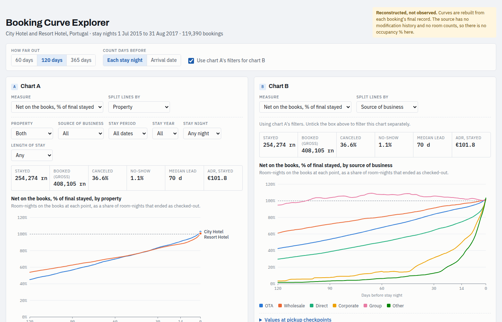

# Hotel RM Research

Revenue-management analysis on the public Hotel Booking Demand dataset
(Antonio, Almeida & Nunes, 2019): 119,390 bookings at a city hotel and a resort
hotel in Portugal, July 2015 to August 2017.

The point of the project is portability. The analysis reads a small canonical
schema, and only one SQL file knows the source's column names. Swap that file
and the same SQL, QA checks and Excel workbook run on another PMS export, with
the data never leaving the machine it lives on.



## What is here

| | |
|---|---|
| `sql/adapters/` | One file per source. Maps source columns to the staging contract |
| `sql/canonical/` | `fact_reservation` (one row per room booking) and `fact_stay_night` (one row per booked room-night) |
| `sql/qa/` | Structural checks that fail the run, and semantic checks that report |
| `sql/marts/` | Booking-curve tables by stay night, source of business and days out |
| `sql/dialect/` | The only engine-specific SQL: two date helpers and a numbers table, for DuckDB, SQL Server and BigQuery |
| `excel/` | A workbook driven by plain SUMIFS formulas, plus Power Query files |
| `artifact/` | A single-page interactive Booking Curve Explorer |
| `data/synthetic/` | A made-up PMS export in a different shape, proving the adapter swap works |
| `docs/` | Schema, source compatibility, QA contract, [BigQuery run](docs/bigquery.md) |

## Run it

Needs [uv](https://docs.astral.sh/uv/) and nothing else installed.

```
uv run --with duckdb scripts/run_pipeline.py --source antonio      # canonical CSVs, QA report, manifest
uv run --with duckdb scripts/run_pipeline.py --source synthetic    # same SQL, different source
uv run --with duckdb scripts/build_artifact.py                     # out/artifact/booking-curve-explorer.html
uv run --with duckdb --with openpyxl scripts/build_workbook.py     # excel/booking_curves.xlsx
uv run scripts/run_bigquery.py --source antonio --project YOUR_PROJECT   # same SQL in BigQuery, checked against DuckDB
```

Python and DuckDB are a convenience for running the SQL locally. The SQL files
can be run in order in any database, and the workbook needs only Excel.
Every step is a `CREATE OR REPLACE TABLE … AS SELECT`, with no `INSERT` or
`UPDATE`, so re-runs are repeatable and it also runs in the free BigQuery
sandbox. [docs/bigquery.md](docs/bigquery.md) has the setup.

## What the curves show

For any stay night, room-nights on the books N days out are everything booked
by then minus everything canceled by then. Dividing by the room-nights that
finally stayed gives a pace curve that is comparable across hotels, seasons and
sources. Two things stand out in this dataset:

- Group business sits above 100% of its final for months, then washes down.
  Corporate and "other" business books mostly inside 30 days.
- 36.6% of booked room-nights cancel. Gross bookings badly overstate demand.

## What this data cannot tell you

- **The curves are reconstructed.** The dataset has each booking's final state,
  not its history. Date and rate changes are invisible, so these are not the
  pickup reports the hotels saw at the time.
- **No occupancy or RevPAR.** Room counts are not published. Nothing here
  invents them.
- **ADR is per booking.** Nightly revenue is an even split, not a rate schedule.
- **Booking date is derived** from arrival date and lead time.
- **Identical rows are kept.** 31,994 rows repeat an earlier row exactly. With no
  reservation number, they cannot be told apart from genuine separate bookings.

## Status

Tested: the DuckDB pipeline on both sources (all structural QA passes), the
same SQL in BigQuery (all 215 per-column aggregates match DuckDB on both
sources), the explorer page's numbers against SQL, and the workbook's formulas
recalculated in LibreOffice.

Not yet tested: the workbook and Power Query files in Excel 365 itself, and the
SQL Server version of the dialect file.

## Roadmap

Each module reads the same canonical tables.

1. Source-of-business mapping and booking-cluster detection
2. Net revenue and NRevPAR under explicit distribution-cost assumptions
3. Cancellation wash by days out
4. Pickup forecasting, and unconstraining tested on simulated demand
5. Length-of-stay controls, displacement and bid prices
6. Pricing and early-booking economics
7. Multi-property capacity

## Data handling

Only two sources are ever loaded into a cloud warehouse, shown in a hosted
dashboard or committed to this repo: the public dataset below and the made-up
export in `data/synthetic/`. The planned BigQuery version follows the same rule.

A private PMS export is handled differently. It runs through the same SQL on the
machine where it already lives, through a local adapter that is not published
here. Its data is never uploaded to a cloud service or an AI tool.

## Data and licence

Antonio, N., de Almeida, A., & Nunes, L. (2019). Hotel booking demand datasets.
*Data in Brief*, 22, 41–49. https://doi.org/10.1016/j.dib.2018.11.126 (CC BY 4.0).
